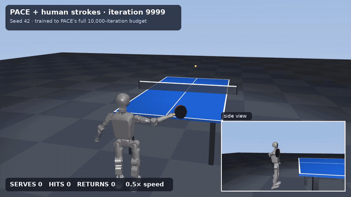
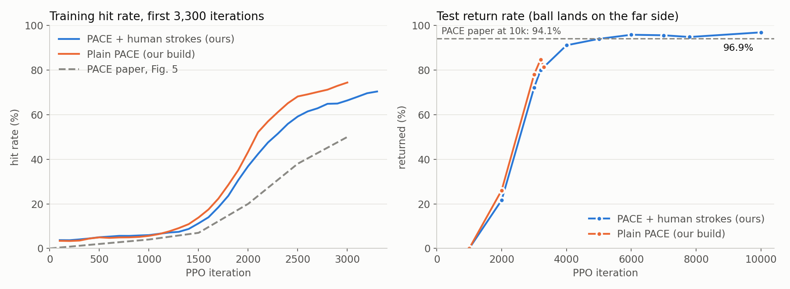
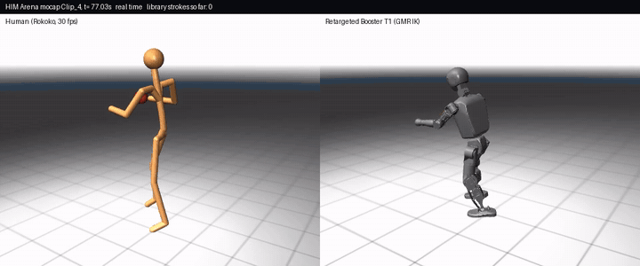
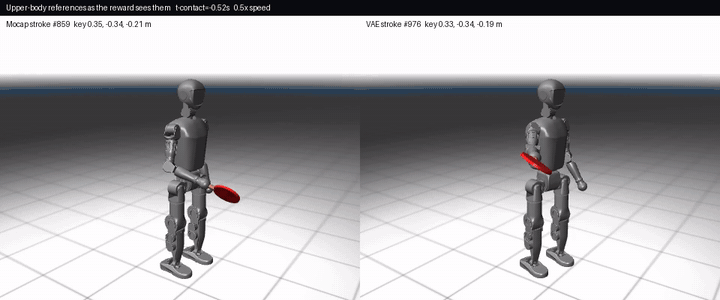
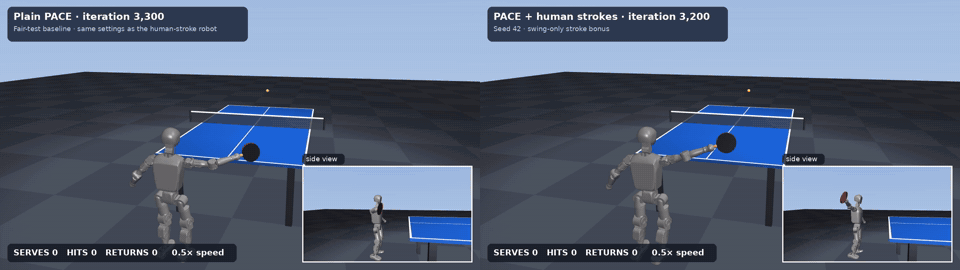

# PACE-exp: humanoid table tennis with PACE + human strokes

Experiments on top of **[PACE](https://arxiv.org/abs/2509.21690)** (ICRA 2026, [purdue-tracelab/TTRL-ICRA2026](https://github.com/purdue-tracelab/TTRL-ICRA2026)), the end-to-end RL policy that lets a Booster T1 humanoid play table tennis. We added a motion prior built from real human ping-pong mocap ([HIM Arena](https://arena.himrobotics.com) `him-table-tennis-v1`), in the style of [SMASH](https://arxiv.org/abs/2604.01158) and [HITTER](https://arxiv.org/abs/2508.21043), and trained the policy for PACE's full 10,000-iteration budget.

<p align="center">
  <a href="media/videos/final_D_10000.mp4"></a><br>
  <sub>Final policy (PACE + human strokes, 10,000 iterations) in IsaacSim, replayed in MuJoCo at 0.5× speed. Click for the full MP4.</sub>
</p>

## Results at a glance

We scored the final checkpoint with **PACE's own `eval.py`, unmodified**, on the paper's four serve ranges, using at least as many serves as the paper did:

| Serve range | Serves | Hit rate | Return rate | Paper serves | Paper hit | Paper return |
|---|---:|---:|---:|---:|---:|---:|
| Long (−6.5 to −6.2 m/s) | 42,237 | **97.4%** | **95.1%** | 42,181 | 96.1% | 92.3% |
| Mid-long (−6.2 to −5.7) | 42,450 | **97.8%** | **96.6%** | 41,390 | 97.0% | 95.0% |
| Short (−5.7 to −5.2) | 92,613 | **99.99%** | **98.5%** | 92,601 | 99.3% | 94.8% |
| Mixed (−6.5 to −5.2) | 89,263 | **98.5%** | **96.8%** | 88,016 | 97.6% | 94.1% |

- **Ahead of the published numbers in all four ranges**, with the same 10,000-iteration budget.
- **Learns about 2× faster early on.** Our build passes a 50% training hit rate at iteration 2,100–2,300; the paper's curve gets there around 3,000.
- **Honest attribution:** a controlled test (below) shows the gain in *hitting and returning* comes from our PACE build (setup fixes and exact 2 ms physics), **not** from the human strokes. The strokes made the swing more human early in training but did not improve play.

<p align="center"></p>

## Videos

| | |
|---|---|
| <a href="media/videos/retarget_human_to_t1.mp4"></a> | <a href="media/videos/vae_strokes.mp4"></a> |
| **Retargeting.** HIM Arena Rokoko mocap (left) mapped onto the Booster T1 with GMR inverse kinematics (right). | **Stroke library.** A real retargeted forehand (left) next to one generated by our motion VAE (right), shown the way the reward sees them. |

<p align="center">
  <br>
  <sub>Same setup, same seed, about 3,200 iterations: plain PACE (left, iteration 3,300) and PACE + human strokes (right, iteration 3,200). They play about equally well.</sub>
</p>

All clips (MP4, 1280×720, broadcast view with a side-view inset):

| Clip | What it shows |
|---|---|
| [final_D_10000.mp4](media/videos/final_D_10000.mp4) | Final policy, PACE + strokes, iteration 10,000 |
| [pace_strokes_7800.mp4](media/videos/pace_strokes_7800.mp4) | PACE + strokes, iteration 7,800 |
| [pace_strokes_3200.mp4](media/videos/pace_strokes_3200.mp4) | PACE + strokes, iteration 3,200 |
| [plain_pace_3300.mp4](media/videos/plain_pace_3300.mp4) | Plain PACE on our build, iteration 3,300 |
| [pace_strokes_1000.mp4](media/videos/pace_strokes_1000.mp4) | PACE + strokes, iteration 1,000 (still learning to hit) |
| [retarget_human_to_t1.mp4](media/videos/retarget_human_to_t1.mp4) | Human mocap and its T1 retarget, side by side |
| [stroke_library.mp4](media/videos/stroke_library.mp4) | Strokes from the library |
| [vae_strokes.mp4](media/videos/vae_strokes.mp4) | Real vs VAE-generated strokes |

> The rollouts run in IsaacSim. IsaacSim's RTX cameras were unavailable on the headless training machines, so `legged_lab/scripts/record_rollout.py` records the exact joint angles, base pose and ball position and `tools/render_v2.py` replays them in MuJoCo.

## What we did

1. **Got PACE training as published.**
   - PACE needs **IsaacLab 2.2.0**, not the 2.1.0 its README states: it uses `quat_apply_inverse` and `is_global`.
   - We added a small compatibility fallback in `legged_lab/physics/aerodynamics.py`.
   - We found that PACE's optional 5 ms "fast" physics setting **halves learning speed**, so every reported run uses the default 2 ms × 10 substeps.
2. **Turned human ping-pong into robot strokes.**
   - Rokoko FBX → Blender (`tools/fbx_to_npz.py`) → [GMR](https://github.com/YanjieZe/GMR) / mink IK onto the T1 (`tools/retarget_rokoko_t1.py`).
   - This yields **1,040 real forehands**: windows of ±0.54 s around peak hand speed (> 1.5 m/s), 54 frames × 9 upper-body joints at 50 Hz.
3. **Grew the library with a SMASH-style conditional motion VAE** (`tools/build_stroke_library.py`).
   - z = 16, hidden size 256, cyclic β ≤ 0.01, smoothness loss.
   - Conditioned on the paddle contact point and the initial pose.
   - We drew 15k samples and filtered them for joint limits, jerk and contact-point consistency, keeping 3,404. The library holds **4,444 strokes**.
4. **Added a swing-gated stroke bonus to PACE** (`legged_lab/envs/base/tt_env_mp.py`, `reward_motion_prior_gated` in `legged_lab/mdp/rewards.py`).
   - **Motion matching:** each step, pick the stroke whose contact point is nearest PACE's physics-predicted hitting point (in the torso-yaw frame).
   - **Phase alignment:** reference frame = 27 − t_apex / 0.02, so the stroke's contact frame lines up with the ball's arrival.
   - **Reward:**

     $$r = 3.0 \cdot \exp\left(-\frac{\sum_j w_j (q_j - q^{ref}_j)^2}{0.6^2}\right)$$

     with w = 1.0 on the right shoulder pitch/roll and right elbow, 0.5 on the waist, 0.3 on the left arm, and 0 on elbow yaw (the wrist is left free, as in SMASH).
   - **Gate:** the bonus only counts from 0.3 s before contact until contact, plus 0.2 s at 2× after a real hit.
   - **The reference goes to the critic only.** The deployed actor and predictor see exactly PACE's inputs, so nothing changes for sim-to-real.
5. **Trained on HIM Arena compute.** Each run used one A40 GPU, 4,096 environments and PACE's PPO settings. The final run, seed 42, trained in three stretches (to 3,500, to 7,800, then to 10,000) as credits allowed.

## Where the gains come from (controlled test)

Same build, same 2 ms physics, test hit / return rate over 2,500 serves:

| Iteration | Plain PACE | PACE + strokes (seed 42) | PACE + strokes (seed 7) |
|---|---|---|---|
| 1,000 | 29.7% / 0% | 21.0% / 0% | 25.6% / 0% |
| 2,000 | 84.4% / 26.1% | 73.0% / 21.7% | 84.9% / 34.3% |
| 3,000 | 98.1% / 78.0% | 96.1% / 72.1% | — |
| 3,200 | 98.4% / 84.8% | 97.8% / 80.0% | — |

The stroke bonus does not improve hitting or returning; plain PACE on our build is already well ahead of the paper's curve. What the strokes do change is **style**: at iteration 1,000 the swing is **16% closer to real human strokes** (0.364 vs 0.434 rad RMS to the nearest library stroke). By about 3,000 iterations both policies converge to a similar swing.

### Why the human motion barely counted

The training logs give each reward term's share of the total positive reward. The stroke bonus was small and shrank as training went on:

| Iterations | 800–1,200 | 1,800–2,200 | 2,800–3,200 | 4,800–5,200 | 7,400–7,800 |
|---|---|---|---|---|---|
| Stroke bonus share | 0.3% | 0.2% | 0.03% | 0.01% | 0.006% |

Three things kept it small:
- The gate is open for only about 0.5 s per serve.
- The kernel is steep: about 0.3 rad of error per joint already cuts the bonus to a third.
- Hitting (+150) and returning (+100, +100, +60) are worth far more.

An earlier always-on version had the opposite problem: it grew past 10× the contact reward and hurt hitting. Making human motion a real training signal would need a larger weight (about 30–100), a wider gate, or a learned style reward such as AMP.

## How stock is the evaluation?

- `legged_lab/scripts/eval.py` is **unchanged** from PACE.
- The final policy runs in our `TTEnvMP` subclass of PACE's environment, because its training critic expects the stroke reference. The actor's observations are identical to PACE's.
- PACE ships one evaluation serve range. We added the long, mid-long and short ranges from the paper's Table II as configs (`t1_tt_mpg_eval_long`, `_mid`, `_short`).
- Setup: IsaacSim 4.5 + IsaacLab 2.2, 1,024 parallel envs. Each run was stopped once it passed the paper's serve count.
- **One training seed.** Raw eval logs are in [`results/official_eval/`](results/official_eval).
- Plain PACE on our build at iteration 3,300 (not 10,000), with the same script on mixed serves, scored 97.6% hits and 81.9% returns over 67,263 serves. That run stopped early when its machine expired.

## Repository layout

```
legged_lab/                 PACE's environment code + our additions
  envs/base/tt_env_mp.py      PACE env subclass: stroke library, motion matching, critic-only reference
  envs/t1_tt/t1_tt_config.py  new tasks: t1_tt_mp, t1_tt_mpg (+ _eval, _eval_long/_mid/_short)
  mdp/rewards.py              reward_motion_prior, reward_motion_prior_gated
  scripts/eval_headless.py    bounded eval + motion-quality metrics (jerk, power, human-likeness)
  scripts/record_rollout.py   records states for offline rendering
rsl_rl/                     PACE's PPO + predictor runner (unchanged)
tools/                      mocap → T1 pipeline, stroke library + VAE, renderers, plot script
motion_prior/               stroke libraries (T1 joint trajectories) and the trained motion VAE
checkpoints/                pace_strokes_10000.pt (final), plain_pace_3300.pt
results/                    official eval logs, per-checkpoint eval JSONs, training curves
docs/guide.html             a long-form technical guide to every design choice (open in a browser)
docs/early_report_*.md      day-one report from the first (fast-physics) experiments
media/                      GIFs, MP4s, figures used in this README
PACE_README.md              PACE's original README
```

## Reproduce

**Install.** Use IsaacSim 4.5.0 + **IsaacLab 2.2.0** (torch 2.5.1, cu121), then:

```bash
pip install -e .
cd rsl_rl && pip install -e . && cd ..
```

**Train** PACE + the stroke bonus (PACE's default 2 ms physics):

```bash
PACE_MP_LIB=motion_prior/stroke_lib_vae.npz python -m legged_lab.scripts.train \
  --task=t1_tt_mpg --num_envs=4096 --headless --logger=tensorboard --predictor --seed 42
```

Plain PACE is `--task=t1_tt` with the same flags. `PACE_MP_W` overrides the stroke-bonus weight (default 3.0).

**Evaluate** with PACE's `eval.py`. It loads checkpoints from `logs/<experiment>/<run>/`, so copy the released checkpoint there first:

```bash
mkdir -p logs/t1_table_tennis_mpg/final && cp checkpoints/pace_strokes_10000.pt logs/t1_table_tennis_mpg/final/model_9999.pt
PACE_MP_LIB=motion_prior/stroke_lib_vae.npz python -m legged_lab.scripts.eval \
  --task=t1_tt_mpg_eval --num_envs=1024 --headless --predictor --load_run final --checkpoint model_9999.pt
# serve ranges: t1_tt_mpg_eval_long | t1_tt_mpg_eval_mid | t1_tt_mpg_eval_short
```

**Rebuild the stroke library** from the HIM Arena mocap. This needs Blender 4.2 and GMR with the `booster_t1` assets:

```bash
blender -b --python tools/fbx_to_npz.py -- <rokoko-fbx-dir> <npz-dir>
python tools/retarget_rokoko_t1.py <npz-dir> <t1-dir>
python tools/build_stroke_library.py --human <npz-dir> --t1 <t1-dir> --xml <GMR>/assets/booster_t1/T1_serial.xml --out motion_prior/
```

**Render a rollout:**

```bash
python -m legged_lab.scripts.record_rollout --task=t1_tt_mpg_eval --load_run final --checkpoint model_9999.pt --headless --out rollout.npz
MUJOCO_GL=osmesa python tools/render_v2.py rollout.npz <GMR>/assets/booster_t1/T1_serial.xml out.mp4 --title "PACE + strokes"
```

## Data

The raw HIM Arena release (Rokoko FBX mocap, Orbbec RGB-D, paddle IMU) is **not** redistributed here; get it from [arena.himrobotics.com](https://arena.himrobotics.com). `motion_prior/` contains only derived T1 joint trajectories and the VAE trained on them.

## Possible next steps

- More seeds for the controlled comparison.
- A stronger style signal: a larger stroke weight, or an AMP-style discriminator.
- Real ball trajectories from the RGB-D sessions, to fit drag, restitution and the serve distribution.
- Backhand strokes.

## Acknowledgements and citation

All credit for the base method and code goes to the PACE authors (TRACE Lab, Purdue). This repository keeps PACE's git history and MIT license. If you use it, please cite PACE:

```bibtex
@misc{hu2026pacephysicsaugmentationcoordinated,
  title={PACE: Physics Augmentation for Coordinated End-to-end Reinforcement Learning toward Versatile Humanoid Table Tennis},
  author={Muqun Hu and Wenxi Chen and Wenjing Li and Falak Mandali and Zijian He and Renhong Zhang and Praveen Krisna and Katherine Christian and Leo Benaharon and Dizhi Ma and Karthik Ramani and Yan Gu},
  year={2026}, eprint={2509.21690}, archivePrefix={arXiv}, primaryClass={cs.RO},
  url={https://arxiv.org/abs/2509.21690}
}
```

We also build on [SMASH](https://arxiv.org/abs/2604.01158) (motion VAE, motion matching), [HITTER](https://arxiv.org/abs/2508.21043) (strike-time phase alignment), [GMR](https://github.com/YanjieZe/GMR) (retargeting), [LeggedLab](https://github.com/Hellod035/LeggedLab), [IsaacLab](https://github.com/isaac-sim/IsaacLab) and [RSL_RL](https://github.com/leggedrobotics/rsl_rl). Mocap and compute came from [HIM Arena](https://arena.himrobotics.com).
